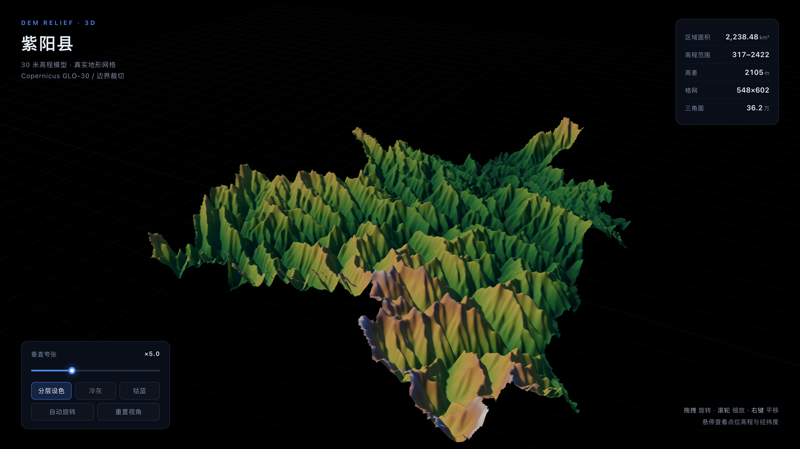
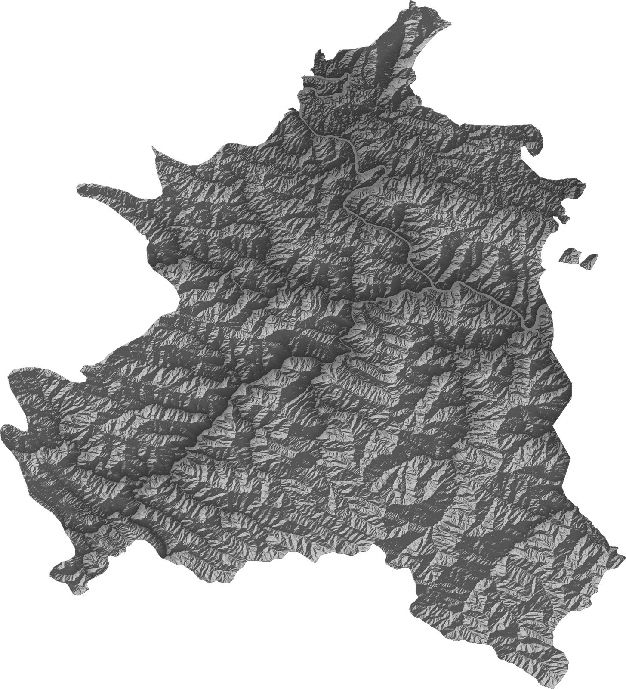
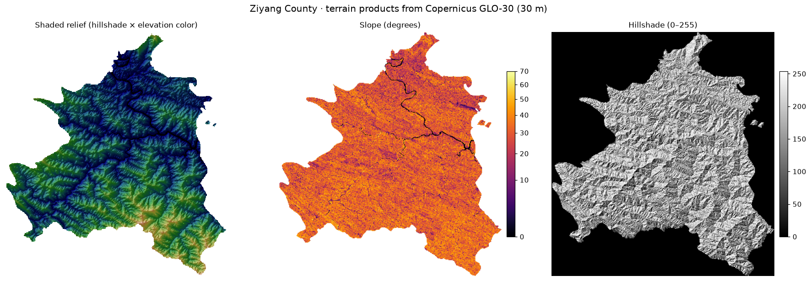
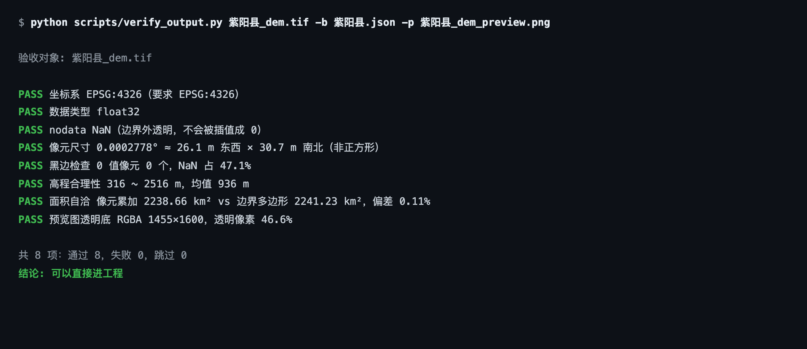
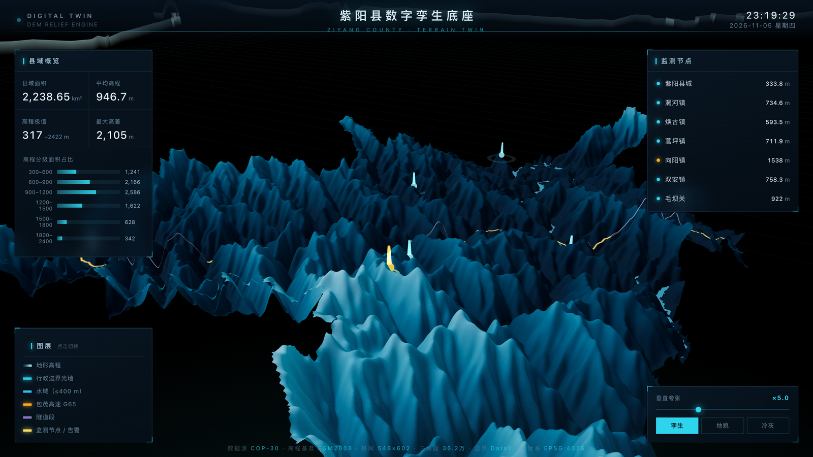

# skill-dem-download · 中国 30 米 DEM 下载与地形产品技能

> 一条命令：**区县名 → 边界 → 下载 Copernicus GLO-30 → 按边界裁切 → 山体阴影预览图**。
> 零 API Key，输出口径固定（EPSG:4326 / float32 / NaN nodata），可直接进 GIS 工程或报表。

[]()
[]()
[]()

这是一个面向**智能体（Agent）和工程师**的技能包：既可以在 Claude / WorkBuddy 等智能体里作为 Skill 自动调用，也可以当一套普通命令行工具用。

---

## 效果预览

**按县界裁切的三维地形（浏览器实时渲染，36 万三角面，全部来自真实 DEM）**



**山体阴影预览图（脚本直接产出，边界外透明、无黑边）**



**地形衍生产品：晕渲设色 / 坡度 / 山体阴影（`terrain_products.py` 一条命令）**



---

## 它解决什么问题

30 米全球 DEM（Copernicus GLO-30）早就免费挂在 AWS 上，不需要申请 Key。真正卡人的不是"下载"，是**口径**：

| 原始数据的坑 | 本技能的处理 |
|---|---|
| 全球 1°×1° 切片，跟行政边界毫无关系 | 自动解析区划 → 定位瓦片 → 合并 → **按边界掩膜裁切** |
| 普遍不声明 nodata，空值是 0 / -32768 | 输出统一 **float32 + NaN nodata**，边界外透明，绝不留 0 值黑边 |
| 国内地图边界是 GCJ-02，影像是 WGS84 | 边界先做 **GCJ-02 → WGS84 迭代反解**（误差 < 1 m）再裁 |
| 垂直基准是 EGM2008 正高 | 统计报告里**写明基准**，提供 `datum_convert.py` 显式换算 |
| 经纬度格网像元不是正方形（约 26 m × 31 m） | 面积按等积计算并在报告中声明，坡度按东西/南北各自尺度计算 |

一句话：**「能下载」和「能进工程」之间隔着的口径，这个技能帮你固定死。**

---

## 安装

```bash
git clone https://github.com/alinkiot/skill-dem-download.git
cd skill-dem-download
pip install -r requirements.txt        # rasterio / shapely / numpy / requests / tqdm / Pillow / pyproj
```

作为智能体 Skill 使用时，把整个目录放进技能目录（如 `~/.workbuddy/skills/cn-dem`）即可，入口说明在 [`SKILL.md`](SKILL.md)。

## 快速开始

```bash
# 1) 按区县名（自动查 adcode → 拉边界 → 下载 → 裁切 → 出预览图）
python scripts/cn_dem.py 紫阳县 out

# 2) 按经纬度范围（WGS84）
python scripts/cn_dem.py hefei out --bbox "117.20,31.80,117.45,32.05"

# 3) 用自己的边界（shp 转 geojson）
python scripts/cn_dem.py area out --geojson my.json
```

产物（四个文件）：

```
out/
├── 紫阳县_dem.tif            成品 DEM（EPSG:4326 / float32 / NaN nodata）
├── 紫阳县_dem_preview.png    山体阴影预览（RGBA 透明底，可直接进文档）
├── 紫阳县.json               行政边界 GeoJSON（已做 GCJ-02 反解）
└── 紫阳县_raw.tif            未裁切中间文件（约 42 MB，可删）
```

## 命令速查

| 命令 | 用途 |
|---|---|
| `cn_dem.py <名字> [目录]` | 一条命令全流程（区县名 / adcode / bbox / geojson） |
| `cn_dem.py 朝阳区 out --parent 长春市` | 同名区划消歧（北京/长春都有朝阳区） |
| `cn_dem.py <名字> out --buffer 500` | 边界外扩 500 m（跨县工程段常用） |
| `cn_dem.py --clean-cache` | 只清瓦片缓存，不触发下载 |
| `terrain_products.py dem.tif --all` | 派生坡度 / 坡向 / 山体阴影（`--az --alt --z-factor` 可调） |
| `dem_stats.py dem.tif --csv hist.csv` | 统计报告：高程分位、面积、直方图（JSON + CSV） |
| `datum_convert.py in.tif out.tif --to ellipsoidal` | EGM2008 正高 ↔ 椭球高换算 |
| `verify_output.py dem.tif -b 边界.json` | **8 项验收自检**（见下文） |
| `export_web3d.py dem.tif` | 导出**浏览器三维地形**（离线可看，见下文） |

## 产物验收：别靠肉眼，跑一遍自检

```bash
python scripts/verify_output.py out/紫阳县_dem.tif \
    -b out/紫阳县.json -p out/紫阳县_dem_preview.png
```



8 项硬指标：坐标系 / 数据类型 / nodata / 像元尺寸 / 黑边 / 高程合理性 / 面积自洽 / 预览透明底。
任何一项失败都会指明原因和修法；全部通过才建议往下交付。也可以 `--json report.json` 存档进交付材料。

实测参考（陕南紫阳县，秦巴山区）：

- 首次运行 **47 秒**（大头是 44 MB 瓦片下载），瓦片有缓存后同样命令 **3.3 秒**
- 3600×3600 像元，有效像元 52.9%，面积 2238.65 km²，与行政面积对得上
- 高程 316–2516 m，坡度均值 30.2°；相邻县（汉阴）复测面积偏差 0.02%

## 浏览器三维地形（不需要 GIS 软件）

```bash
python scripts/export_web3d.py out/紫阳县_dem.tif --name 紫阳县
# 输出 紫阳县_dem_web3d/ 目录，双击 start.command（Windows: start.bat）
```

拖拽旋转、滚轮缩放、悬停读高程和经纬度、垂直夸张 1–14 可调。three.js 已本地化，**完全离线**。
这一步的意义：把"一张打不开的 tif"变成"谁都能转着看的三维地形"，汇报和交底时不用装任何软件。

想再进一步（叠水系、边界光墙、道路、监测点做成数字孪生大屏），见 [docs/digital-twin.md](docs/digital-twin.md) ——
同一份 DEM 上叠图层就是下面的效果，所有图层都来自真实数据：



---

## 提示词示例（给智能体 / AI 助手）

把本仓库装成 Skill 后，下面这些说法可以直接用。**核心约定：区县名或范围 + 你要什么产品。**

### 基础取数

```text
帮我下载陕西紫阳县的 30 米 DEM，按县界裁好，出一张预览图
→ cn_dem.py 紫阳县 out
```

```text
我要 117.20,31.80 到 117.45,32.05 这块范围的高程数据
→ cn_dem.py hefei out --bbox "117.20,31.80,117.45,32.05"
```

```text
下载长春的朝阳区地形（注意不是北京那个）
→ cn_dem.py 朝阳区 out --parent 长春市
```

```text
用我这个 shp 转的 geojson 裁一块 DEM
→ cn_dem.py area out --geojson my.json
```

### 分析与产品

```text
给我这块区域的坡度图和坡向图，坡度超过 35° 的范围帮我标出来
→ terrain_products.py dem.tif --all （超 35° 筛选交给智能体用 numpy 完成）
```

```text
出一份高程统计报告：min/max/均值/分位数/面积/高程直方图
→ dem_stats.py dem.tif --json stats.json --csv hist.csv
```

```text
把高程从 EGM2008 正高转成椭球高，后面要和 GPS 实测点比对
→ datum_convert.py in.tif out.tif --to ellipsoidal
```

### 质量与交付

```text
跑完帮我验收一下：坐标系、黑边、面积自洽这些都要查，报告存档
→ verify_output.py dem.tif -b 边界.json --json report.json
```

```text
做一个能转的三维地形，明天给甲方演示
→ export_web3d.py dem.tif --name 项目名
```

### 场景复合（智能体自动拆解）

```text
我们在做安康片区的风电选址，把汉阴、紫阳、岚皋三个县的 DEM 和坡度都准备好，
坡度小于 15° 的连片区域挑出来，并出一份能进报告的统计表
→ 智能体会依次运行三个县的 cn_dem.py（瓦片共享缓存），再逐县 terrain_products + dem_stats，
   最后汇总筛选。跨县瓦片只下载一次。
```

> **提示词写法建议**：说清「地名/范围 + 产品（tif/坡度/统计/3D/验收）+ 用途」。
> 用途很重要——例如"要算土方"会触发基准换算与实测校准提醒，"只做底图"则直接出图。

---

## 应用场景

| 场景 | 用哪些输出 | 口径提醒 |
|---|---|---|
| **电力选线 / 线路走廊** | DEM + 坡度 + 剖面 | 关注 `--buffer` 外扩；走廊比选看坡度分带（>35° 难工段） |
| **风机 / 站址选址** | DEM + 坡度 + 统计 | 连片缓坡筛选；注意 DSM 在林区的树高偏置 |
| **边坡监测 / 地灾** | DEM + 坡向 + 剖面 | 30 m 分辨率做趋势判断可以，**不能替代实测剖面** |
| **汇水 / 内涝初判** | DEM + 统计 | GLO-30 是 DSM，城区建筑会整体抬高地貌，内涝要慎重 |
| **报告底图 / 汇报配图** | `_preview.png` / 3D / 三联图 | 预览图透明底，可直接叠到任意底图上 |
| **数字孪生底座** | `export_web3d.py` 产物 | 继续叠水系、边界、点位、道路即可成大屏（见 docs） |
| **土方 / 高程比对** | `datum_convert.py` | EGM2008 vs 1985 基准差 ±0.5 m 内但随区域变化，**必须实测校准** |

## 输出规格（固定口径）

```
坐标系      EPSG:4326（WGS84 地理坐标）
数据类型    float32
nodata      NaN（边界外透明；如下游软件不支持可 --nodata -9999）
格网        1/3600°（赤道处约 30.9 m；东西向随纬度收窄，非正方形）
高程基准    EGM2008 正高（报告写明，可显式换算）
预览图      RGBA 透明底 PNG
数据源      Copernicus GLO-30 Public on AWS Open Data（免 Key）
边界源      阿里 DataV 行政边界（GCJ-02，已迭代反解到 WGS84，误差 < 1 m）
```

## 已知边界（诚实声明）

- **分辨率 30 m**：满足底图、趋势分析、走廊比选；测绘级 1:1 万成果请走正规授权链路
- **DSM 不是 DTM**：含植被与建筑高度，城区均值被抬高（参考：合肥城区约 +34 m）
- **不解决测绘资质与验收标准**：它把 80% 的准备工作从几天压到几十分钟，剩下 20% 仍需专业人员
- 对外发布涉界成果图请遵守地图审图规范

## 常见坑与修法

详见 [docs/pitfalls.md](docs/pitfalls.md)（黑边、瓦片拼缝、GCJ-02 偏移、高程基准四大坑的机理与修法）。

## 目录结构

```
skill-dem-download/
├── SKILL.md                    智能体技能定义（需求映射表 / 参数 / 坑）
├── README.md                   本文件
├── requirements.txt
├── scripts/
│   ├── cn_dem.py               一键入口（区划名/bbox/geojson → tif + 预览）
│   ├── resolve_boundary.py     区划解析（DataV，GCJ-02 反解，同名消歧）
│   ├── fetch_cop30.py          瓦片下载（curl 分块 + 并发 + 校验 + 缓存）
│   ├── clip_by_boundary.py     掩膜裁切（NaN nodata，防黑边）
│   ├── preview_dem.py          山体阴影预览（RGBA 透明底）
│   ├── terrain_products.py     坡度 / 坡向 / 山体阴影
│   ├── dem_stats.py            统计报告（JSON + CSV 直方图）
│   ├── datum_convert.py        EGM2008 ↔ 椭球高
│   ├── verify_output.py        ★ 8 项产物验收自检
│   └── export_web3d.py         ★ 导出浏览器三维地形（离线可看）
├── web3d/                      三维查看器（three.js 本地化）
├── examples/                   示例与提示词（examples/prompts.md）
├── docs/                       口径、坑、数字孪生集成
└── images/                     本页截图（全部来自真实运行）
```

## 性能与缓存

- 下载用 **curl HTTP Range 分块 + 字节校验 + 二分重试**，弱网环境下不会拿到"不报错的坏文件"
- 全局连接池默认 16 并发（实测 8/16/24 并发聚合吞吐 88/114/122 KB/s，16 为收益拐点）
- 瓦片缓存在 `scripts/_cache/tiles/`，**跨工作目录共享**：相邻县、同市多县只下载一次

## 致谢

- 数据：[Copernicus GLO-30 Public](https://registry.opendata.aws/copernicus-dem/)（AWS Open Data，免 Key）
- 边界：[阿里 DataV GeoAtlas](http://datav.aliyun.com/portal/school/atlas/area_selector)
- 三维渲染：[three.js](https://threejs.org/)（MIT）
- 技能源自 [chwang9/DEM-Download-Skill](https://github.com/chwang9/DEM-Download-Skill) v2.4.0，本仓库在其上补充验收自检、三维导出与应用文档
