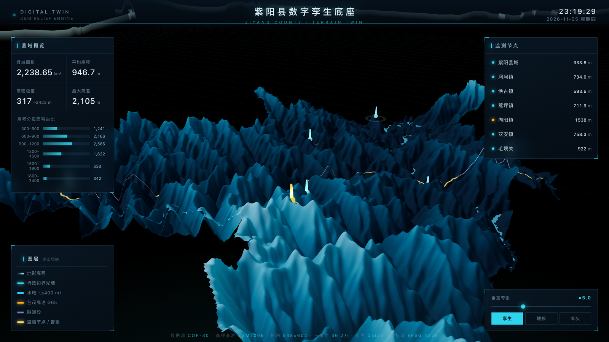

# 数字孪生集成指南

`export_web3d.py` 的产物是一个自足的三维地形查看器。本文说明如何把它推进成
"数字孪生底座"——地形 + 水系 + 边界 + 动态点位的大屏。



## 分层结构（从底到顶）

| 层 | 数据来源 | 生成方式 |
|---|---|---|
| 1. 地形底座 | `<县>_dem.tif` | `export_web3d.py`：抽稀 → 平滑 → 高度场 + 三角索引 |
| 2. 水系 | 同一份 DEM | 按"高程 ≤ 阈值"提取淹没面（紫阳用 400 m，按河谷高程定） |
| 3. 行政边界光墙 | `<县>.json` | 边界线环逐点采样 DEM 高程，生成贴地竖直光墙 |
| 4. 静态点位 | 业务数据 | 经纬度 → DEM 采样高程 → 三维定位 + 光柱 |
| 5. 动态数据 | 业务接口 | WebSocket / 轮询 JSON，驱动告警点位与面板 |
| 6. 线状要素（可选） | OpenStreetMap | Overpass API 取道路几何 → 沿线重采样 → DEM 贴地 |

## 关键实现细节（都是踩过的坑）

1. **抽稀与平滑**：3600×3600 全分辨率浏览器扛不住。按 stride 分块均值抽稀到
   长边 ~620 格（约 60 万三角面），再做 NaN 安全的 3×3 平滑。
   **索引只连四角都有效的格元**——边界外自动镂空，不会出现一张"贴地方片"。

2. **垂直夸张**：真实比例下山区三维"看着很平"。查看器把垂直夸张做成滑块
   （1–14），出图建议 5–10。这是 3D 效果好坏的第一变量，比渲染引擎重要。

3. **点位坐标必须乘像元尺寸**：把"格网下标"换算成"千米坐标"时少乘一步 dx，
   点位会飞到场外悬空。这是孪生场景最常见 bug，表现为"光柱悬在半空"。

4. **光柱别跟随地形缩放**：垂直夸张改变地形 scale.y 时，父节点下的光柱会被
   同步放大成穿天柱。解法：光柱高度固定于世界坐标，做反向补偿（scale.y = 1/exag）。

5. **线状图层（道路/管线）贴地**：线宽 60 m 在全县场景里不到半像素，必须加宽 +
   加辉光；且渲染网格是抽稀平滑过的，原始 DEM 高程会把线埋进山体。
   解法：从**渲染网格**插值高程（不是原始 DEM），再整体抬升数十米 + 深度偏移。

6. **坐标偏移**：和 docs/pitfalls.md 坑三同理——GCJ-02 的点位直接放进 WGS84 场景
   会偏几百米。链路上任何一环都不能漏转。

## 接入真实业务

查看器只是前端壳。把右侧节点列表、告警点位换成你们系统的实时接口即可：

```js
// 每隔 5s 拉一次节点状态，替换 twin.json 里的示例数据
setInterval(() => fetch('/api/nodes').then(r => r.json()).then(renderNodes), 5000);
```

再加图层就是继续堆：管线走向线、桥梁模型、视频融合、倾斜摄影……地形底座不变。

## 性能参考

| 项 | 数值（紫阳县，548×602 格网） |
|---|---|
| 三角面 | 36.2 万 |
| 高度场 | 1.3 MB |
| 索引 | 4.1 MB |
| 首屏加载 | 局域网 < 1 s，本机瞬时 |
| 渲染 | three.js WebGL，核显 60 fps |

浏览器侧建议单场景 ≤ 100 万三角面；更大范围用 LOD 或 Cesium 地形瓦片方案（quantized-mesh）。
